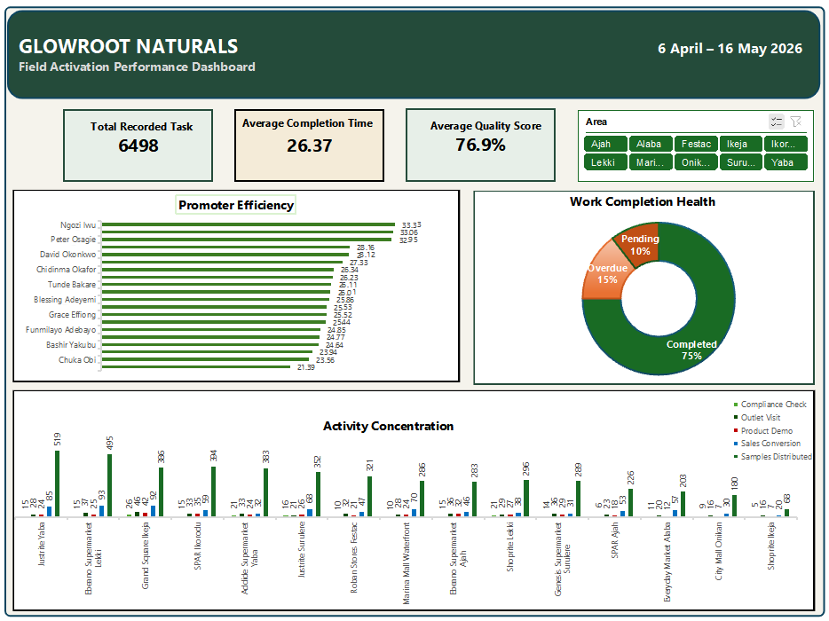

# GlowRoot Naturals – Field Activation Performance Analysis

## Project Overview

This project focuses on analysing the field activation performance of **GlowRoot Naturals**, a skincare and haircare brand conducting promotional activities across retail outlets in Lagos, Nigeria.

The analysis examines field promoter activities, task completion status, completion time, quality scores and activity distribution across different promoters, areas and retail outlets.

The goal is to transform raw activity records into meaningful business insights that can help the Trade Marketing team monitor performance, identify operational gaps and make informed decisions.

## Business Problem

GlowRoot Naturals records daily activities carried out by field promoters across different retail locations. However, monitoring performance across multiple promoters, outlets and task categories can become challenging when the information is viewed only as individual records.

The business needs a clearer way to understand:

- How much field activity is being recorded.
- How efficiently promoters complete their assigned activities.
- Whether activities are completed, overdue or pending.
- Which promoters and locations require closer attention.
- How activity levels differ across task types and retail outlets.

This project addresses these needs through data analysis and an interactive Excel dashboard.

## Project Objectives

The main objectives of this project are to:

1. Organise and structure the field activation dataset.
2. Measure total recorded task units.
3. Evaluate average activity completion time.
4. Analyse overall quality performance.
5. Examine the distribution of activity statuses.
6. Compare promoter efficiency and performance.
7. Identify activity patterns across areas and retail outlets.
8. Provide actionable recommendations based on the findings.

## Dashboard Preview

The dashboard provides a visual summary of the field activation performance, including key performance indicators, promoter efficiency, activity concentration and work completion status.

**Want to explore the full analysis?**

[Click here to view and download the Excel workbook →](abigail-abilawon.xlsx)

## Dataset Overview

The dataset contains field activation records covering the period from **6 April to 16 May 2026**.

| Dataset Information | Details |
|---|---:|
| Total Records | 1,506 |
| Number of Columns | 9 |
| Promoters | 20 |
| Areas | 10 |
| Retail Outlets | 15 |
| Task Types | 5 |
| Status Categories | 3 |

**Key Dataset Fields:**

- Date
- Promoter Name
- Area
- Outlet Name
- Task Type
- Tasks Completed
- Completion Time (mins)
- Quality Score (%)
- Status

## Key Performance Indicators (KPIs)

The analysis focuses on three main performance indicators:

| KPI | Result |
|---|---:|
| Total Recorded Task Units | 6,498 |
| Average Completion Time | 26.37 minutes |
| Average Quality Score | 76.9% |

*Note: Total Recorded Task Units represents the sum of the Tasks Completed column across all records, including Completed, Overdue and Pending statuses.*

## Key Findings

### 1. Work Completion Status

Out of 1,506 activity records:

- Completed: 1,130 records (75.0%).
- Overdue: 219 records (14.5%).
- Pending: 157 records (10.4%).

Although most recorded activities have a Completed status, 376 records remain either overdue or pending. This highlights the need for consistent follow-up and monitoring.

### 2. Activity Distribution

Samples Distributed contributed approximately 72% of all recorded task units, while Outlet Visit had the highest number of activity records, with 434 records.

This shows that activity volume and the number of activity records provide different perspectives on field performance.

### 3. Promoter Performance

The analysis identified differences in promoter efficiency and quality scores.

Ngozi Iwu, Segun Ogundipe and Peter Osagie recorded higher average completion times and lower average quality scores compared with the other promoters.

These differences indicate areas that may require further performance review and support.

### 4. Area Performance

Yaba recorded the highest total task units, with 1,164 units.

Ikorodu recorded the lowest completion rate at approximately 66.9%, making it an important area for further monitoring.

### 5. Completion Time by Task Type

Product Demo recorded the highest average completion time at approximately 39.70 minutes, while Compliance Check had the lowest at approximately 14.45 minutes.

This information can help management review task scheduling and identify activities that require more time.

### 6. Outlet Performance

The five highest-volume outlets accounted for approximately 45.5% of all recorded task units.

This indicates that a significant proportion of campaign activity is concentrated in a relatively small number of outlets.

## Business Recommendations

Based on the findings, the following recommendations are proposed:

1. **Monitor outstanding activities:** Review overdue and pending records regularly and establish a consistent follow-up process.
2. **Support promoter performance:** Investigate performance differences and provide targeted coaching or training where necessary.
3. **Review Product Demo processes:** Examine ways to improve preparation and execution while maintaining quality.
4. **Monitor lower-performing areas:** Pay closer attention to locations with lower completion rates, particularly Ikorodu, Ajah and Alaba.
5. **Review outlet activity distribution:** Assess whether promoter allocation and field activities align with outlet priorities.
6. **Improve activity tracking:** Consider adding task due dates and other tracking fields to support better monitoring.
7. **Clarify task measurements:** Separate activity counts from quantities such as samples distributed to make future comparisons more meaningful.

## Tools and Techniques

**Tools Used:**
- Microsoft Excel

**Techniques and Features:**
- Data organisation and quality checks
- Excel Tables
- PivotTables
- PivotCharts
- KPI summaries
- Interactive Area slicer
- Excel Dashboard Design

## Project Files

The following files will be made available in this repository:

- **Excel Workbook:** Contains the structured dataset, PivotTables, charts and interactive dashboard.
- **Dashboard Image:** A visual preview of the completed dashboard.
- **Business Analysis:** Detailed findings, insights and recommendations.

## Conclusion

This project demonstrates how Excel can be used to transform field activation records into meaningful business insights.

The analysis highlights differences in promoter performance, outstanding activities, task completion time and activity distribution across locations.

The resulting dashboard provides a clearer view of campaign performance and supports better monitoring and operational decision-making.

**The ultimate goal is to turn field data into actionable insights that help businesses make better decisions.**
